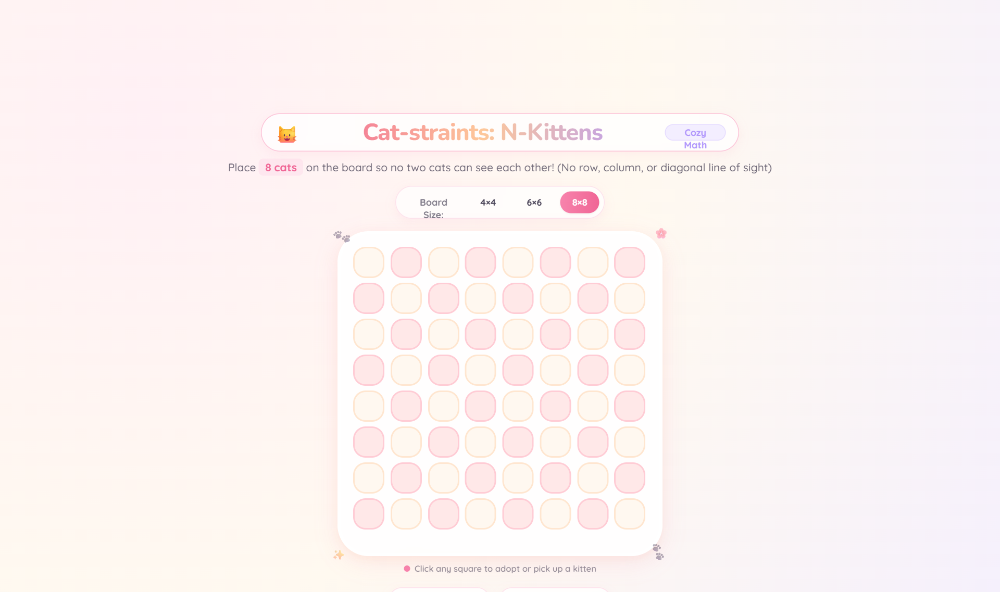

# 🐱 Cat-straints: The N-Kittens Challenge

> **A cozy, cute N-Queens puzzle adventure with adorable kittens, conflict animations, sparkle bursts, and an animated AI solver! ✨**



A charming, minimalist educational web application for exploring the classic **N-Queens Constraint Satisfaction Problem (CSP)** with an adorable twist: chess queens are replaced by cuddly kittens!

---

## ✨ Features

* **🐾 Cozy Aesthetic:** Warm pastel cream, strawberry milk pink, peach, and lavender theme with playful typography and rounded cards.
* **🐱 Dynamic Cat Reactions:**
  * 😸 **Safe Kitty:** Floating happily when placed without any line-of-sight attacks.
  * 😿 **Alarmed Kitty (`>_<`):** Gently trembling with a soft red glow when sharing a row, column, or diagonal with another cat.
  * 👑 **Royal Crown:** When the puzzle is solved, all cats celebrate with golden crowns!
* **✨ Sparkle Bursts:** Placing a safe cat triggers a mini sparkle burst; solving the puzzle unleashes a dazzling shower of colorful sparkles (`✨`, `🌟`, `💖`, `🐾`, `🌸`) and a victory banner.
* **🪄 Animated AI Solver:** Watch the backtracking solver place cats one-by-one with sparkles until a valid harmony is found.
* **🔊 Cute Web Audio:** Gentle plops, pops, and victory fanfare synthesized via the Web Audio API (100% offline, zero audio files required, toggleable anytime).
* **🎚️ Board Sizing:** Quick one-click switches between **4×4**, **6×6**, and **8×8** boards.

---

## 🚀 How to Run

The project is completely self-contained in a single lightweight file with zero build steps or dependencies:

1. **Directly in Browser:** Double-click [`index.html`](index.html) or drag it into any modern web browser (Chrome, Edge, Safari, Firefox).
2. **Local HTTP Server:**
   ```bash
   python -m http.server 8080
   ```
   Open `http://localhost:8080` in your browser.
3. **GitHub Pages:**
   Under repository **Settings > Pages**, set branch to `main` and folder to `/ (root)` to play online!

---

## 🎓 The Math / CSP Formulation

The N-Queens problem is formally modeled as a **Constraint Satisfaction Problem (CSP)**:
* **Variables ($X$):** $X = \{X_0, X_1, \dots, X_{N-1}\}$, where variable $X_i$ represents the cat placed in row $i$.
* **Domains ($D$):** For each variable $X_i$, $D_i = \{0, 1, \dots, N-1\}$, representing the column index.
* **Constraints ($C$):** For all $i \neq j$:
  1. **Column constraint:** $X_i \neq X_j$
  2. **Diagonal constraint:** $|X_i - X_j| \neq |i - j|$

A state is a solution if and only if all $N$ kittens are placed with **0 conflict pairs**.
